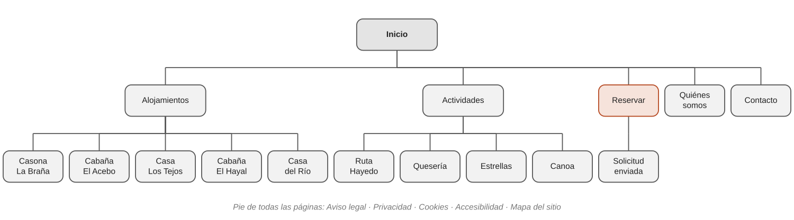

# Mapa del sitio · Hayedo Rural (solución modelo)

## 1. Inventario de contenidos
- Presentación de la empresa, lema, historia, valores, equipo
- 5 alojamientos: fotos, descripción, plazas, servicios, tarifas por temporada, ubicación
- 4 actividades: descripción, duración, precio, vídeo
- Solicitud de reserva (formulario) y confirmación
- Datos de contacto, horario, formulario breve, cómo llegar, mapa de la comarca
- Opiniones de clientes
- Textos legales: aviso legal, privacidad, cookies, declaración de accesibilidad

## 2. Agrupación
| Sección | Contenidos que agrupa |
|---|---|
| Alojamientos | Listado + 5 fichas (galería, servicios, tarifas, mapa) |
| Actividades | 4 actividades con vídeo |
| **Reservar** (botón destacado) | Formulario de solicitud → página de confirmación |
| Quiénes somos | Historia, valores, equipo, mapa interactivo de la comarca |
| Contacto | Teléfono, correo, horario, formulario breve, cómo llegar |

«Inicio» no ocupa un hueco en el menú: el logotipo enlaza con la portada (convención).

## 3. Árbol del sitio
```
Inicio (index.html)
├── Alojamientos (alojamientos.html)
│   ├── Casona La Braña   (alojamientos/casona-la-brana.html)
│   ├── Cabaña El Acebo   (alojamientos/cabana-el-acebo.html)
│   ├── Casa Los Tejos    (alojamientos/casa-los-tejos.html)
│   ├── Cabaña El Hayal   (alojamientos/cabana-el-hayal.html)
│   └── Casa del Río      (alojamientos/casa-del-rio.html)
├── Actividades (actividades.html)
├── Reservar (reservar.html)
│   └── Solicitud enviada (reserva-enviada.html)
├── Quiénes somos (quienes-somos.html)
└── Contacto (contacto.html)

Pie: Aviso legal · Privacidad · Cookies · Accesibilidad
```
Estructura **mixta**: árbol principal ancho y poco profundo (2 niveles), un tramo **lineal** (reserva) y enlaces transversales (de cada ficha a las actividades cercanas y a Reservar con el alojamiento preseleccionado).



## 4. Navegación
- **Global:** logo (→ inicio) + Alojamientos · Actividades · Quiénes somos · Contacto + botón «Reservar».
- **Local:** en las fichas, enlaces a los otros 4 alojamientos.
- **Migas de pan:** en las fichas (Inicio › Alojamientos › Casa Los Tejos).
- **Contextual:** desde cada ficha a la actividad más cercana; desde actividades a los alojamientos del valle.
- **Pie:** contacto rápido (tel:, mailto:) y enlaces legales.

## 5. Contraste con IA (ejemplo)
- **Incorporado:** separar «Reservar» como botón y no como una opción más del menú (refuerza la jerarquía visual).
- **Descartado:** crear una sección «Blog» propuesta por la IA: Hayedo Rural no tiene recursos para mantenerla y el briefing no la pide.
